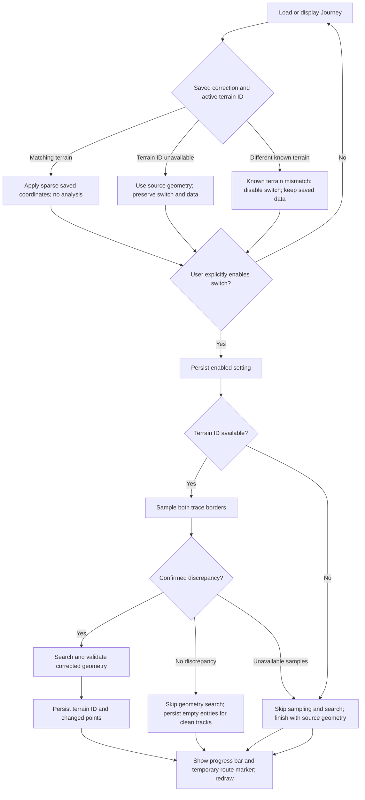

# GPX Terrain Alignment

## Journey setting

Each Journey persists an `antiCliffCorrection` boolean and may persist an `antiCliffCorrectionData` object. The boolean defaults to `false` only for older saved Journeys that do not contain the field; a saved `true` value remains enabled after reload. The Journey Settings Data panel always shows the switch. Loading, displaying, calculating metrics for, or replaying a Journey never starts a terrain check or correction search. Only an explicit switch activation starts the check and, when needed, the correction search.

With correction disabled, rendering and Replay use source GPX geometry. The on-demand check samples both rendered trace borders at each eligible GPX point and runs the existing discrepancy detector. It does not search for replacement positions or alter track geometry. Clean checks skip correction search; incomplete terrain samples are reported as unavailable and also skip correction search.

The check samples two terrain positions per eligible GPX point, in batches capped at 512 positions. It checks tracks sequentially. A temporary ground-clamped marker follows the current GPX point during sampling; after a discrepancy is detected, it stays on the first point selected for correction while the search runs. The marker is removed when the operation finishes. The correction search, including its one-metre lateral scan and geometry validation, starts only for tracks where the on-demand check finds a discrepancy. During the operation, the Data panel shows a Web Awesome progress bar weighted by each track's GPX point count; the switch and progress bar use equal-width columns. The bar covers checking and correction and disappears after the Journey redraw finishes.

After processing, `antiCliffCorrectionData` stores the selected terrain catalogue ID and a sparse correction list per processed track. Each correction records only a changed point: its segment index, coordinate index, source coordinate, and corrected coordinate. A processed track with no changed coordinates has an empty list; unprocessed tracks have no entry. The object never stores full track geometry, and the source GPX coordinates are not mutated.

## Startup and Replay

Startup and ordinary rendering apply saved coordinates synchronously only when the active terrain ID matches the saved terrain ID. Replay reads the same saved or already prepared geometry through `getTerrainAlignedTrackContent`; it does not wait for or start alignment. The original `track.content` remains the source GPX data; corrected geometry is derived separately.

If the active terrain ID is temporarily unavailable, Studio preserves the saved switch and correction data, uses source geometry, and waits for an explicit user action before any analysis. If a known active terrain ID differs from the saved terrain ID, Studio turns the switch off, keeps the saved object tied to its original terrain, and uses source geometry. If a saved source coordinate no longer matches the GPX point at its stored index, Studio disables correction and discards that stale correction object.

## Data flow

