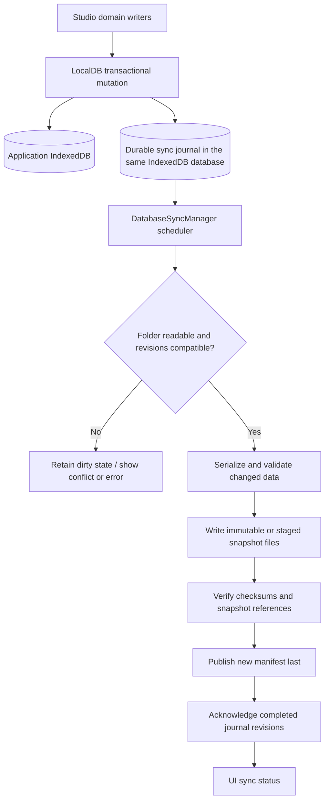

# Core Local Database Synchronization: Reliability and Incremental Sync

> **Status:** Proposed specification — pending technical and product validation  
> **Reviewed:** 2026-10-31  
> **Repository:** `lgs1920/studio`  
> **Scope:** Browser IndexedDB and synchronization with a user-linked local folder. Cloud providers, remote APIs, and automatic cross-device merging are out of scope.

## 1. Purpose and decision summary

Studio already persists application data in IndexedDB and mirrors it to a linked directory through the File System Access API. The existing solution is suitable for local backup and basic single-session mirroring, but it is not a crash-safe, bidirectional synchronization protocol.

**Recommendation:** Preserve `LocalDB` and the existing local-first architecture. Harden startup and restore semantics first, then add durable change tracking, serialized and resumable writes, snapshot validation, and finally incremental exports. Treat automatic record-level merge as a separate, explicitly approved decision.

The priorities below are proposals, not implemented behavior. No performance improvement or data-loss guarantee is claimed without the proposed tests.

### Canonical references

- [Current internal database architecture](../specs/data/CORE-INTERNAL-DATABASE-ARCHITECTURE.md)
- [LocalDB API reference](../specs/data/CORE-LOCALDB-API-REFERENCE.md)
- [Settings synchronization guide](../specs/data/SETTINGS_SYNC_GUIDE.md)
- [Internal database maintenance skill](../../skills/lgs-1920-studio-internal-database/SKILL.md)
- [DatabaseSyncManager](../../src/core/db/DatabaseSyncManager.js)
- [DatabaseExportImportUtils](../../src/core/db/DatabaseExportImportUtils.js)
- [LocalDB](../../src/core/db/LocalDB.js)
- [LGS1920Context](../../src/core/LGS1920Context.js)
- [Current sync tests](../../src/__tests__/unit/data/database-sync-manager.test.js)

## 2. Current implementation — verified from source

### 2.1 Boundaries and stored data

- `LGS1920Context.createDB()` creates the `lgs1920`, `settings`, and `vault` `LocalDB` instances. Application databases use an environment-dependent suffix.
- `LocalDB` owns the IndexedDB record envelope, cache, transactions, and `put`/`delete`/`clear` mutation notifications.
- `DatabaseExportImportUtils` serializes stores into JSON and ZIP. Journeys have one file per journey, while most other stores have one file per store.
- `DatabaseSyncManager` persists the directory handle, client ID, last manifest signature, and UI state in the separate `lgs1920-sync-state` database.
- The folder is local only and requires browser support for `showDirectoryPicker`. There is no server-side synchronization endpoint.

### 2.2 Startup and ongoing synchronization

1. At bootstrap, a previously linked folder is reopened when permission is available.
2. `#importFromLinkedDirectory(..., {clearBeforeImport: true})` clears every managed application store before importing available JSON files.
3. `flushToPersistentDirectory({force: true})` then exports the imported state back to the folder, bypassing normal conflict detection.
4. After bootstrap, a successful application mutation schedules a two-second debounced flush.
5. Each flush exports the entire managed database collection, removes stale managed JSON files, and sequentially writes files and `.lgs-sync/manifest.json`.
6. Normal conflict detection depends on the manifest client ID, signature, and timestamps. The existing `overwritePersistentDirectory()` intentionally bypasses that check.

The current format is a **whole-collection mirror**, not a per-record synchronization protocol. Documentation already acknowledges that ZIP and folder imports are not transactional.

## 3. Risk assessment

| Priority | Observed condition | Consequence | Required direction |
| --- | --- | --- | --- |
| P0 | Linked-folder bootstrap clears local stores before full validation | Empty, partial, or corrupt folders can cause data loss | Validate first, then stage and apply a controlled restore |
| P0 | A two-second timer is the only pending-write mechanism | Closing or reloading can lose changes when the folder wins next startup | Persist change state atomically with the application write |
| P0 | Files are deleted and overwritten sequentially | An interrupted flush can leave an inconsistent folder | Versioned snapshots, integrity verification, and manifest-last publication |
| P0 | ZIP import while linked may reload before the delayed folder flush | Imported data can be overwritten by the linked folder | Coordinate import, sync disposition, and reload explicitly |
| P1 | Same-client manifests bypass conflict checks | Two tabs or sessions using one client ID can overwrite each other | Revision-based checks and same-origin write coordination |
| P1 | `flushToPersistentDirectory()` has no single-flight guard | Concurrent flushes can race on files and status | Serialize flush operations and recheck dirty revisions |
| P1 | Each mutation exports all three databases | Unnecessary read, serialization, and filesystem I/O | Track dirty scopes/stores/records and export only changed content |
| P1 | A scheduled background flush can retain `synced` status | UI can imply durability while local changes are pending | Represent dirty changes independently from the last completed sync |
| P1 | LocalDB cache can return an incomplete envelope for `get(..., true)` | Exported metadata may be missing after cached payload reads | Cache a complete envelope and invalidate index caches |
| P1 | A failed `LocalDB.put` leaves a per-key wait promise unresolved | A later write to the same key can stall | Always release the per-key write guard on failure |
| P2 | `exportedAt` changes on every serialization | Comparing serialized bytes produces false positives | Separate canonical data fingerprints from export metadata |
| P2 | Sync-state storage is not environment-suffixed | Distinct development/production databases may share sync metadata | Scope sync metadata by environment and migrate deliberately |

Additional security risk: the existing ZIP/folder format includes `vault` credentials as clear JSON. The proposed sync work must not silently change this behavior or imply encryption.

## 4. Required behavior and invariants

### 4.1 Data safety

1. A committed local application write must remain recoverable after a browser restart, even when the linked folder is unavailable or stale.
2. No startup path may clear application stores solely because a linked folder is empty, unreadable, unverified, or incomplete.
3. Never declare a folder snapshot current until all referenced files have been written and verified.
4. Keep the last verified snapshot recoverable until the replacement is committed and validated.
5. Failed operations must not discard the durable dirty state or silently advance the last acknowledged revision.
6. A conflicted import or overwrite must require an explicit user decision. There must be no implicit last-writer-wins merge.
7. Unrelated files in a selected folder must never be modified or deleted.
8. Existing JSON and ZIP backups must remain importable unless an incompatible-format migration is separately approved.

### 4.2 Runtime behavior

- IndexedDB remains the active source of truth during an application session. The linked folder is an exchange and recovery target, not an unconditional source of truth.
- Sync must operate without an external service, and manual ZIP export/import must remain available when folder access is unsupported.
- A runtime import must rehydrate affected settings and provider-token consumers before displaying the data as active, or perform an explicit reload after a successfully completed import.
- `syncState` must distinguish **last completed sync** from **pending unsynchronized changes**.
- Different browser tabs using the same origin should coordinate writes with a same-origin lock. Cross-browser filesystem races require additional revision checks and cannot be eliminated by `navigator.locks` alone.

## 5. Proposed architecture



### 5.1 Startup state machine

Before any destructive import, inspect the linked manifest, required paths, supported format, checksums, and persisted local dirty state. Proposed decisions:

| Linked folder | Local state | Startup decision |
| --- | --- | --- |
| New or empty | Existing local data | Preserve local data. Offer explicit folder initialization from IndexedDB. |
| Verified snapshot | Empty or explicitly uninitialized local data | Restore the verified snapshot. |
| Verified snapshot identical to last acknowledged version | Clean local data | Start without rewriting all files. |
| Verified snapshot | Unacknowledged local changes | Preserve local data, compare revisions, and either resume export or surface a conflict. |
| Divergent verified snapshot | Divergent local revisions | Block automatic overwrite and request resolution. |
| Missing, partial, unsupported, or corrupt snapshot | Any | Preserve local data and show a recoverable error. |
| Permission denied | Any | Continue locally and retain durable pending changes. |

The initial folder-link action must distinguish **initialize folder from local data**, **restore from existing folder**, and **cancel**, with a clear warning before any destructive restore. A legacy folder without a manifest needs a separate, non-destructive compatibility flow.

### 5.2 Durable change journal

Proposed logical record (illustrative, not an existing schema):

```js
{
    scope: 'lgs1920',
    store: 'journeys',
    key: 'journey-123',
    operation: 'put',
    revision: 42,
    status: 'dirty'
}
```

- Persist the journal entry and the application mutation in **one IndexedDB transaction in the same database**. A separate `lgs1920-sync-state` transaction is insufficient for this guarantee.
- Each managed application database can own a private journal store, requiring an intentional IndexedDB version upgrade and a `LocalDB` transaction API extension. Private journal stores must be excluded from normal backup/export payloads unless explicitly specified.
- Record deletions using tombstones until the corresponding snapshot acknowledges them. Represent store clears as revisioned operations with explicit precedence.
- Persist a monotonic local revision and the highest acknowledged revision per database. Use a composite sync identity scoped to the application environment and linked folder.
- A failed flush retains pending entries. Recovery scans and resumes the durable journal; timers only coalesce work and are never the source of truth.
- Individual databases can commit independently, but **there is no atomic transaction across the three application databases**. The snapshot protocol must therefore validate a consistent published generation or retry if revisions change during export.

### 5.3 Serialized flush and retry behavior

- Enforce one active flush per manager instance. Use `navigator.locks` where available for cooperating same-origin tabs, and a fallback that never claims cross-process mutual exclusion.
- Capture the journal revision boundary before export. After publishing the snapshot, acknowledge only mutations up to the verified boundary, then schedule another pass if newer changes exist.
- On recoverable I/O errors, retain the journal and retry with capped exponential backoff and jitter. Permission denial and conflicts require separate handling and must not trigger silent overwrites.
- `pagehide` and `visibilitychange` may request a best-effort flush, but persistence must be correct even when the browser terminates without firing events.
- Persist last successful sync details and error context. Never indicate success for an unfinished or partially written generation.

### 5.4 Snapshot format and integrity

A versioned manifest should identify a complete, immutable generation and the exact file revisions used for that generation. One candidate structure is:

```json
{
  "version": 2,
  "generation": "generation-id",
  "parentGeneration": "previous-generation-id",
  "writerId": "browser-session-or-installation-id",
  "writtenAt": "2026-10-31T00:00:00.000Z",
  "files": {
    "lgs1920/journeys/journey-123.json": {
      "revision": 42,
      "objectPath": ".lgs-sync/objects/object-id.json",
      "sha256": "expected-file-digest",
      "size": 1024
    }
  }
}
```

The example is a **design candidate**, not a final or implemented contract. File sizes and digests above are illustrative. In particular, `generation`, object layout, and direct editability of journey files require validation before selecting a v2 format.

- Write new file content to immutable versioned paths (or an equivalent staging layout) before publishing the manifest.
- Validate file existence, length, and content checksum before considering a generation committed. FNV-1a from v1 is not suitable as a strong integrity guarantee; a stronger digest, such as SHA-256, is a candidate to benchmark.
- Publish the manifest after all referenced files are ready. On restart, ignore incomplete generations and retain the last verified generation.
- Do not delete content referenced by the current or previous recoverable generation. Garbage collection of older objects is a later, explicit step.
- File System Access does not provide a multi-file atomic transaction or cross-device compare-and-swap. Manifest-last publication improves recovery but does not, by itself, prevent concurrent writers on a shared filesystem.
- Preserve compatibility with the existing v1 manifest, `lgs1920/`, `settings/`, and `vault/` roots. Define migration and the policy for user edits to exported JSON before changing the on-disk layout.

### 5.5 Incremental export and cache consistency

- Track dirty data by database and store first, then by record where it materially reduces I/O.
- Retain per-journey JSON files. Evaluate per-record POI/widget files against migration complexity and compatibility requirements before adopting them.
- Keep a stable canonical payload representation or per-record fingerprint independent of `exportedAt` and other volatile export timestamps.
- Add a bulk snapshot read API to avoid `keys()` followed by one transaction per `get()` where feasible.
- Cache full `LocalDB` envelopes consistently for both `get(..., false)` and `get(..., true)`. Invalidate affected index caches after `put`, `delete`, and `clear`, and respect TTL expiration on cached results.
- Ensure the per-key `#writingKeys` guard is released on rejected writes, so subsequent writes cannot hang.
- Avoid changing `LocalDB.set` and `LocalDB.update` aliases as part of the sync feature unless separately tested and scoped.
- Benchmark actual workload sizes before setting fixed performance targets or changing the persisted layout.

### 5.6 UI and security

- Keep existing status values for compatibility, but derive a separate persisted `dirtyCount` or `hasPendingChanges` flag instead of using `synced` alone to imply current durability.
- Show last successful sync, pending work, conflicts, permission state, and an explicit **retry** action.
- Conflict resolution should initially offer **keep local**, **restore folder**, and **cancel**, with preview/backup safeguards. Automatic merge is out of scope.
- Keep `vault` handling explicit: current folders and ZIP archives contain unencrypted provider tokens. Warn users, preserve the current contract during an incremental rollout, and require a separate approved decision for encryption or exclusion changes.
- Do not introduce browser-specific native filesystem path assumptions; a `FileSystemDirectoryHandle` exposes a name, not a guaranteed absolute path.

## 6. Delivery plan

### Phase 1 — P0 data safety

1. Introduce non-destructive startup classification, manifest/file validation, and an explicit initial-link choice.
2. Protect ZIP import and reload while a linked directory is active.
3. Make folder publication recoverable and prohibit pre-publication destructive cleanup.
4. Correct the two `LocalDB` consistency failures affecting full-envelope caching and failed per-key writes.
5. Add deterministic regression tests for corruption, empty folders, aborted writes, and reload recovery.

**Exit criteria:** No tested failure path silently clears valid local records or claims a partially written folder is synchronized.

### Phase 2 — P1 durable synchronization

1. Define and migrate a same-database journal store for each managed application database.
2. Extend `LocalDB` for atomic mutation plus journal entry.
3. Implement a single-flight, revision-aware flush and durable acknowledgement.
4. Add retry/backoff and multi-tab coordination.
5. Expose pending changes and conflict states to the settings UI.

**Exit criteria:** A locally committed write survives a reload before the debounce fires and is eventually exported without losing later revisions.

### Phase 3 — P1/P2 incremental performance

1. Introduce stable change fingerprints and dirty store/record selection.
2. Avoid full exports when only one journey or settings section changes.
3. Introduce batch reads for large stores where supported.
4. Benchmark export latency, number of files written, and bytes processed on representative datasets.
5. Preserve fallback import and backup compatibility.

**Exit criteria:** A single-record mutation updates only the necessary logical content and associated manifest metadata, without a full database re-export.

### Phase 4 — P2 operations and recovery UX

1. Present synchronization history and actionable error information.
2. Provide snapshot verification and a safe rollback/restore flow.
3. Document browser permission limitations, platform scoping, and vault security.

**Exit criteria:** Users can distinguish local durability, pending folder writes, conflicts, and completed synchronization without inspecting developer tools.

## 7. Verification and acceptance matrix

| Scenario | Acceptance condition | Suggested test level |
| --- | --- | --- |
| First link to an empty folder with existing local data | No local clear, explicit initialization path | Unit + integration |
| Bootstrap with corrupt/missing JSON | Original IndexedDB data remains intact | Integration |
| Browser closes before debounce | Dirty entry survives and export resumes | IndexedDB integration |
| Filesystem write fails mid-generation | Last published snapshot remains restorable | File System Access integration |
| ZIP restore while a folder is linked | Restored records are not silently replaced on reload | Integration + UI |
| Two tabs modify the same key | Conflicting revisions are not silently acknowledged | Integration |
| Same-client manifest changes externally | Conflict check does not bypass revision comparison | Unit |
| New mutation arrives during flush | Only exported revisions are acknowledged, new mutation stays dirty | Unit + integration |
| File content changed without manifest update | Import detects digest mismatch or explicit legacy limitation | Integration |
| `LocalDB.put` fails, then retries same key | No unresolved wait promise | Unit against fake IndexedDB |
| Cached payload is followed by `get(..., true)` | Complete envelope and TTL metadata remain available | Unit against fake IndexedDB |
| `put` or `delete` changes indexed widget membership | Subsequent index read reflects the new state | Unit against fake IndexedDB |
| Manual ZIP and legacy v1 folder | Existing supported data still imports correctly | Compatibility integration |
| Permission revoked during sync | Local writes remain available and dirty work persists | Integration |
| Production and development environments coexist | No cross-environment sync-state contamination after migration | Integration |
| Unrelated JSON in chosen root | File is preserved | Unit + integration |

Existing test entry points:

```bash
bunx --bun vitest run \
  src/__tests__/unit/data/database-export-import-utils.test.js \
  src/__tests__/unit/data/database-sync-manager.test.js
```

Add focused `LocalDB` and File System Access tests, then run the affected Vitest project with CI-equivalent parallelism. Run lint and any required typecheck/build checks for subsequent implementation changes. Do not run `bun run dev`.

## 8. Decisions requiring validation

1. **Disk layout:** Keep directly editable per-journey files, or adopt immutable content-addressed objects with a compatibility/export view. This choice determines snapshot publication and merge behavior.
2. **Initial link:** Should an empty folder always offer local initialization, and must a non-empty legacy folder require an explicit restore confirmation?
3. **Conflicts:** Adopt conservative whole-file revision conflicts first, or invest in field/record-level merge. The latter is excluded from the initial recommendation.
4. **Vault:** Preserve current cleartext inclusion temporarily, or introduce a separate, approved secret-handling policy before changing synchronization behavior.
5. **Retention:** Decide the number and age of verified generations kept for rollback and the storage budget for garbage collection.
6. **Environment migration:** Define how existing unsuffixed `lgs1920-sync-state` handles and signatures are assigned to an environment without breaking the current user connection.

## 9. Scope and handoff

**In scope:** A reviewed design and later changes to `LocalDB`, `DatabaseSyncManager`, `DatabaseExportImportUtils`, startup/restore wiring, existing profile sync UI, and focused tests.

**Out of scope:** Google Drive/OneDrive/Dropbox synchronization, new backend services, a new state-management library, automatic cross-device record merge, and unrelated Cesium/replay features.

**Current status:** This document is an audit and implementation proposal. It does not describe an already deployed fix. No repository code or tests were changed as part of authoring the specification. When approved for delivery, link it from `tech-doc/README.md` and `tech-doc/todo/README.md`, submit documentation through a pull request, and merge through the repository's required review workflow.